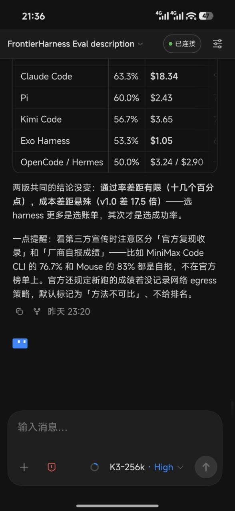
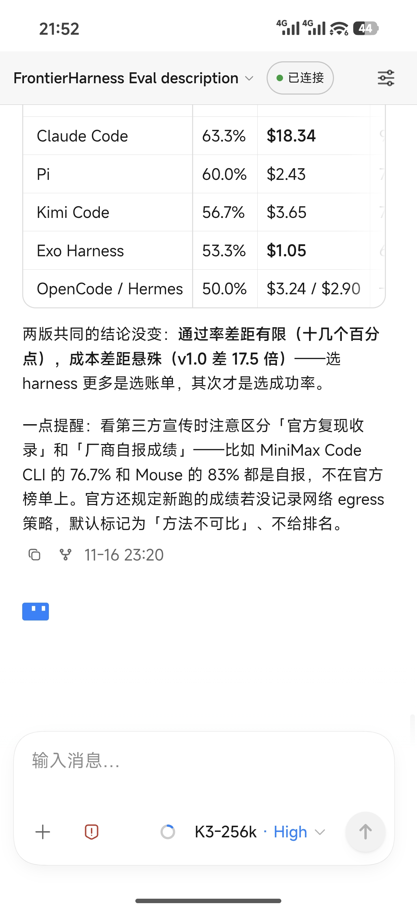
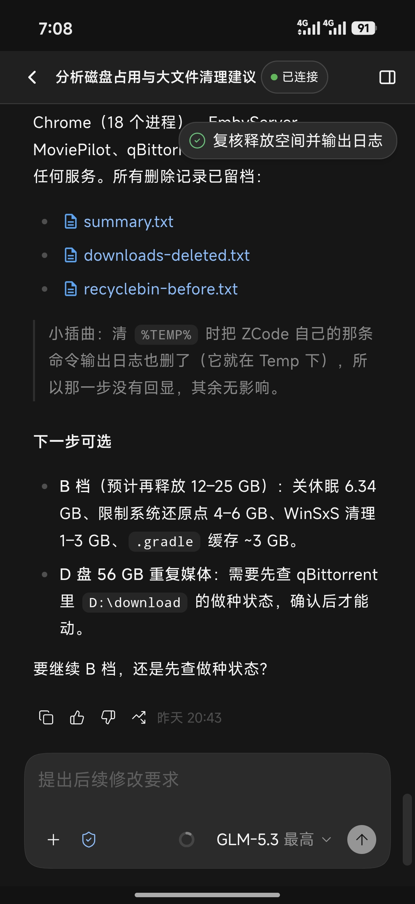
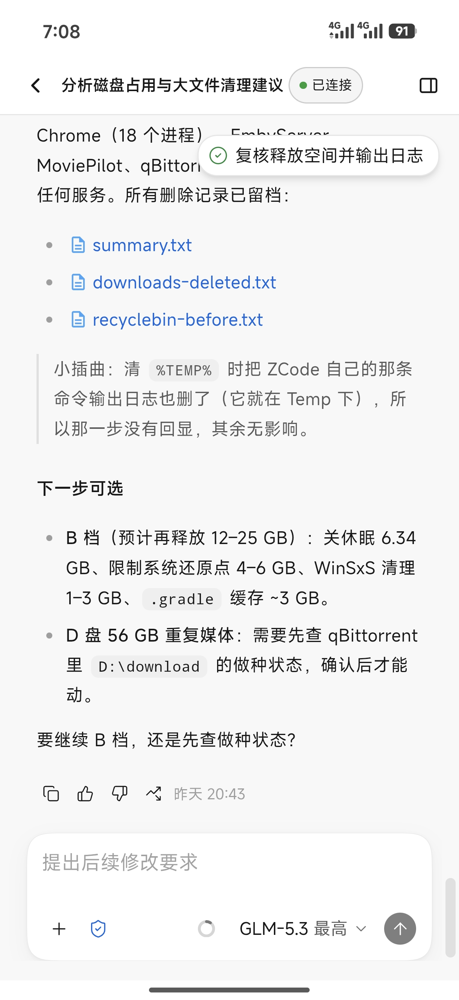

# KShell


Kimi Code / ZCode 桌面端「远程控制」的手机壳客户端。非官方、开源、零收集。

配对有三种入口：相机扫码、粘贴链接、从相册选一张二维码截图（PNG/JPEG 解码全在本地做，没有为此引入原生依赖）。凭据进加密存储，官方控制台跑在一个加固的 WebView 里；账号登录在你设备上的官方页面内完成，登录态由系统 WebView 保管（登录一次，重启免登录）。官方网页给不了的部分——凭据管理、应用锁、多机收藏、移动端体验修补——由这个壳补齐。

> ⚠️ 非官方项目，与 Moonshot AI、智谱均没有关联，也未获授权。你需要自己的、已开启「远程控制」的桌面端（Kimi Code 远程控制还需你本人的 Kimi 账号及相应会员权益；ZCode 远程控制需你本人的 ZCode 账号登录）。细节见[免责声明](./docs/DISCLAIMER.md)。

## 界面预览

**Kimi Code**

| 深色主题 | 浅色主题 |
|---|---|
|  |  |

**ZCode**

| 深色主题 | 浅色主题 |
|---|---|
|  |  |

控制台顶栏与主题随系统深色模式自动切换（小米 17 实机截图）。Kimi 会话页顶栏交互集中在两处：点击会话标题即可切换会话；点击「已连接」胶囊弹出菜单，可选「返回列表」（结束当前视图，回到客户端列表）、「下载管理」和「重新加载」。ZCode 会话页的四条工具栏同样合并为一条：`‹（网页返回） | 会话标题 | ● 连接胶囊 | 侧栏`——点连接胶囊展开菜单（返回列表 / 所有会话 / 下载管理 / 重新加载 / 原会话菜单 / 主题），侧栏只开关侧栏，断线时胶囊变为「重连」。

## 下载

从 [KShell Releases](https://github.com/Martin-ding0918/KShell/releases/latest) 下载 ARM64 APK。

## 功能

- **Kimi Code 远程控制**：支持官方 .com 和 .ai 远程控制台，可管理多台设备
- **ZCode 远程控制**：支持官方 relay v2 配对（zcode.z.ai / zcode.chatglm.site），会话页四栏合一顶栏
- **网页登录管理**：登录在应用内完成，登录态跨重启保留（可关闭），机器卡片实时显示登录状态，支持一键退出 / 清除全部网页数据
- **机器管理**：自定义命名、收藏置顶、手动排序；同一台机器重复配对会合并记录并更新凭据
- **加密存储**：配对凭据 AES 落盘，密钥托管在 Android Keystore，明文不落闪存
- **应用锁**：指纹 / 人脸、图案、密码可同时启用，任意一种都能解锁；后台切回自动重新上锁
- **连接状态与通知**：控制台顶部实时状态条；断线、被顶下线、Agent 等待批准时发本地通知
- **独立版本**：使用同签名的 KShell 安装包覆盖升级
- **下载管理**：更新包和页面下载的文件统一列在一处，进度、暂停继续、取消、打开、删除、失败重试
- **行为补丁**：document-start 注入、带探针自退役，比如修掉"回车变成发送"的问题
- **合规**：首次启动弹《用户协议》《隐私政策》同意门，设置里有法律文档中心；不收集任何数据
- **体验细节**：系统返回键先走网页历史、无历史再回应用；边到边适配；键盘会把输入框顶起来

## 架构

```
KShell/                            # npm workspaces monorepo
├── packages/
│   ├── core-shell/              # 零框架依赖的纯 TS 核心：配对 / 状态机 / 机器注册表 / 应用锁 / 加密
│   └── patch-bundle/            # 注入官方页面的行为补丁
└── apps/mobile/                 # React Native 0.82 应用（Android 先行）
```

一条原则：**逻辑单源**。core-shell 不依赖任何框架，平台能力通过接口注入。展开见[架构设计](./docs/architecture.md)。

## 快速开始

环境：Node ≥ 22、npm ≥ 12、JDK 17–21、Android SDK（API 36）。已知坑见[构建指南](./docs/build.md)。

```bash
npm install                          # 安装全部依赖（含 npm patch）
npx vitest run                       # core-shell 单元测试
cd apps/mobile/android
./gradlew assemblePublicRelease      # 构建公开 ARM64 APK（需配置正式签名）
```

本项目 fork 自 [Amwidtf/zshell](https://github.com/Amwidtf/zshell)；源码与公开安装包均在本仓库维护。

## 安全与隐私

零收集是底线：无后端、无账号、无遥测，所有数据只在本机加密存储里。配对凭据等同密码，建议在桌面端定期轮换；远程会话经官方中继传输，处理敏感代码库前自己权衡。全文：[隐私政策](./docs/PRIVACY.md)、[安全说明](./docs/SECURITY.md)、[免责声明](./docs/DISCLAIMER.md)。

## 文档

| 文档 | 内容 |
|---|---|
| [CHANGELOG.md](./CHANGELOG.md) | 更新日志 |
| [CONTRIBUTING.md](./CONTRIBUTING.md) | 参与贡献指南 |
| [docs/architecture.md](./docs/architecture.md) | 架构设计 |
| [docs/build.md](./docs/build.md) | 构建指南与已知坑 |
| [docs/release.md](./docs/release.md) | 发版流程 |
| [docs/compliance.md](./docs/compliance.md) | 合规实现 |

## 开发方式

这个项目用 AI 结对的方式开发：ZCode 编程智能体（GLM 模型驱动）写了几乎全部代码和文档，人类维护者负责提需求、做技术决策和验收。提交历史就是这份协作的记录。

## 许可

[MIT](./LICENSE)。基于 React Native 等开源软件构建，许可证清单见应用内"开源许可"。
